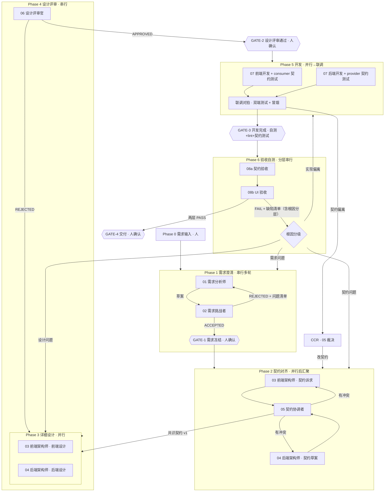

# 多智能体协同开发流程

把一个需求拆成 6 个阶段，由 8 个角色 Agent 在阶段门控下协作完成。

## 核心机制

### 1. 契约先行（Contract-First）
前后端并行设计最大的坑是「各写各的、评审时才发现对不上」。解法：**先对齐接口契约，再写详细设计**。
契约是唯一真相源，任何一方发现契约问题，走 `contract-change-request` 变更流程，**不得私自改**。

### 2. 阶段门控（Gate）
每个阶段有出口标准。未达标 → 本阶段内循环修订，`max_rounds = 3` 熔断升级给人。

### 3. 结构化交接
Agent 间状态传递走 `schemas/handoff.schema.json`。禁止用大段自然语言转述上游产出——下游只拿到 `artifacts` 里的文档路径 + 自己的 `context_budget`。

### 4. 双向信号
接收方必须回 `ACCEPTED / REJECTED / NEEDS_CHANGE`。`REJECTED` 必须带 `reject_reasons`（可执行的修订项，不是「我觉得不好」）。

### 5. 上下文预算
每个 Agent 的 `context_budget` 显式声明它需要读哪些文档。编排者按预算投递，不转发全量历史。
这条直接治「Agent 重复提问」——它问，是因为没拿到该拿的东西。

### 6. 事实性假设核查（Assumption Verifiability）
流程能拦住「歧义」（02 挑战者）和「设计不自洽」（06 评审），但拦不住「**把不存在的东西当成存在的**」——03 写「复用既有 BaseTable」，而代码库里根本没有这个组件，需求、契约、评审全绿，直到开发阶段才炸。

规则：

> 任何 Agent 在文档里写「复用既有 X / 依赖已有 Y / 沿用 Z」，**必须附代码库路径**（如 `src/components/base-table/index.ts`）。给不出路径的标 `UNVERIFIED`，该假设不得进入下游文档。

06 评审按 rubric 维度 9 对资产陈述抽检要路径；GATE-1/GATE-2 有对应勾项。

### 7. 契约测试（Contract Testing）
前后端并行开发的耦合点不在代码，在契约。联调不是「接起来试试」：
- Phase 5 两侧各自按 LOCKED 契约写契约测试——前端 consumer 测试（mock 与契约逐字段一致，最好从契约生成）、后端 provider 测试（真实响应与契约一致）。
- 联调 = 双端契约测试对跑 + 真实环境主流程冒烟。对不上 → 判哪侧偏离契约 → 偏离方走 CCR，**不许改 mock 迁就实现**。

## 流程总览



## 阶段说明

| Phase | 名称 | 并行性 | 角色 | 产出 | 出口门控 |
|---|---|---|---|---|---|
| 0 | 需求输入 | — | 人 | 原始需求 | — |
| 1 | 需求澄清 | 串行多轮 | 01 / 02 | `requirement-spec.md` | GATE-1 |
| 2 | 契约对齐 | 并行→汇聚 | 03 / 04 / 05 | `interface-contract.md` | 契约零冲突 |
| 3 | 详细设计 | 并行 | 03 / 04 | `frontend-design.md` / `backend-design.md` | 符合契约 |
| 4 | 设计评审 | 串行 | 06 | `design-review-report.md` | GATE-2 |
| 5 | 开发实现 | 并行→联调 | 07 | 代码 + 契约测试 + 联调对拍 | GATE-3 |
| 6 | 验收自测 | 分层串行 | 08a 契约层 → 08b UI 层 | `acceptance-report.md`（两层结论） | GATE-4 |

## 角色清单

| ID | 角色 | 文件 | 做什么 | 不做什么 |
|---|---|---|---|---|
| — | 编排者 | [`agents/00-orchestrator.md`](./agents/00-orchestrator.md) | 调度、投递上下文、守门控、熔断 | 不产出业务内容 |
| 01 | 需求分析师 | [`agents/01-requirement-analyst.md`](./agents/01-requirement-analyst.md) | 澄清需求、写需求规格 | 不做技术选型 |
| 02 | 需求挑战者 | [`agents/02-requirement-critic.md`](./agents/02-requirement-critic.md) | 挑刺、找歧义/遗漏/不可测项 | 不写方案 |
| 03 | 前端架构师 | [`agents/03-frontend-architect.md`](./agents/03-frontend-architect.md) | 前端契约诉求 + 前端设计 | 不定后端实现 |
| 04 | 后端架构师 | [`agents/04-backend-architect.md`](./agents/04-backend-architect.md) | 后端契约草案 + 后端设计 | 不定前端交互 |
| 05 | 契约协调者 | [`agents/05-integration-negotiator.md`](./agents/05-integration-negotiator.md) | 对齐前后端契约差异 | 不裁决业务优先级（升级给人） |
| 06 | 设计评审官 | [`agents/06-design-reviewer.md`](./agents/06-design-reviewer.md) | 按 rubric 评审并给结论 | 不改设计 |
| 07 | 开发工程师 | [`agents/07-developer.md`](./agents/07-developer.md) | 按设计文档实现 | 不改设计/契约（走 CR） |
| 08 | 验收自测 | [`agents/08-qa-acceptance.md`](./agents/08-qa-acceptance.md) | 分层验证：L1 契约层 + L2 UI 层 | 不修 bug；不把单层 PASS 写成 PASS |

## 流程分级（按需求规模选档）

不是所有需求都值得跑满 6 个阶段。编排者在 Phase 0 结束时定档，写进 handoff 的 `task_level`：

| 档 | 判据（默认值，团队可调） | 流程 |
|---|---|---|
| **S 小改动** | 单模块、不新增接口或仅 1 个、无数据模型变更、AC ≤ 3 条 | 01（简版 spec：目标 + AC）→ 03/04 合并出契约草案 → 05 快审 → 07 → 08 只跑 L1。跳过 02；GATE-1/2 合并为一次人确认 |
| **M 标准** | 跨 1-2 模块、接口 ≤ 5 个、有简单数据变更、AC ≤ 10 条 | 完整流程；02 可只跑一轮；GATE-2 可并入 GATE-1 之后的首次人确认 |
| **L 完整** | 跨 ≥ 3 模块、接口 > 5 个、数据模型变更不可逆、AC > 10 条 | 完整流程，一道门不少 |

**拿不准就按 M 跑**——降档后悔成本低；升档意味着已跳过的阶段要补。契约先行与资产可验证两条规则**任何档位都不跳过**（它们正是小需求最容易裸奔的地方）。

## 编排器工具（执行器）

00-orchestrator 的约定由 [`tools/orchestrator.mjs`](./tools/orchestrator.mjs) 落地：状态持久化、handoff 结构校验、gate 自动检查、CCR 记录。零依赖 Node ≥ 18，单文件。

```bash
node tools/orchestrator.mjs init --task <id> --level M   # 建任务
node tools/orchestrator.mjs status --task <id>           # 看进度（断点恢复入口）
```

- **AUTO vs MANUAL**：artifact 存在性、契约 LOCKED/版本对齐、OPEN CCR、round≤3、测试命令退出码由工具判定；语义质量只打印 👤 提醒，由 `gate --confirm` 显式确认——**工具不替人点头**。
- **只进不退**：`advance` 不提供回退命令；返工按缺陷根因分层回对应阶段（见流程图 RT 节点），回退是决策不是操作。
- 已 PASSED 的 gate 不被后续自动检查降级（人确认过的历史结论），未过项转遗留提醒。
- 完整子命令与参数见 [`tools/README.md`](./tools/README.md)。

## 使用方式

1. **启动**：把原始需求交给 `00-orchestrator`，编排者创建 `task_id` 并初始化 handoff。
2. **逐阶段推进**：每个阶段结束，编排者校验 gate（见 [`checklists/gates.md`](./checklists/gates.md)），达标才发下一轮 handoff。
3. **人工确认点**：GATE-1（需求冻结）、GATE-2（设计评审通过）、GATE-4（交付）必须停等人。
4. **产出落地**：所有文档写到 `<项目>/.workbuddy/runs/<task_id>/` 下，模板见 [`templates/`](./templates/)。
5. **断点恢复**：`runs/<task_id>/state.json` 是运行的唯一真相源（结构见 `agents/00-orchestrator.md`）。中断后新会话先读它，从当前 `phase` 续跑，已 PASSED 的 gate 不重跑。

## 防踩坑

- **不要让两个架构师直接对话**：走 05 协调者。点对点协商会发散，且没有仲裁记录。
- **不要让开发 Agent 改契约**：它觉得契约不对，提交 `contract-change-request` 给 05，由 05 裁决并同步双方。
- **不要让验收 Agent 修 bug**：它只报缺陷清单，回 Phase 5。修验一体会掩盖问题。
- **不要让验收缺陷无脑回 Phase 5**：先判根因——契约问题回 Phase 2、设计问题回 Phase 3、需求问题回 Phase 1、实现偏离才回 Phase 5。
- **不要转发全量历史**：按 `context_budget` 投递，token 是乘法级放大的。
- **REJECTED 必须可执行**：「这个设计不好」不是理由，「P2 接口缺分页参数，会导致列表超 1000 条时 OOM」才是。
