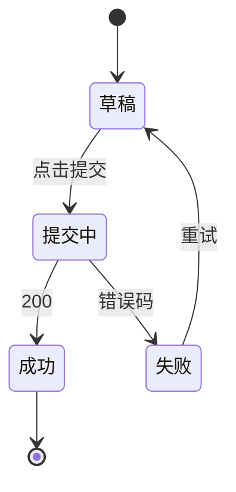

# 前端设计 · <需求名>

> task_id: `<id>` · 版本: v1 · 依赖契约: `interface-contract.md` v<n> (LOCKED)
> 作者: 03 前端架构师

## 1. 概述

- **目标**：<对应需求 spec 的哪些验收标准>
- **范围**：页面/组件清单
- **不在本文范围**：<如：后端实现、埋点平台配置>

## 2. 页面与路由

| 路由 | 页面 | 入口 | 权限 |
|---|---|---|---|
| `/xxx` | XxxPage | 侧边栏「XX」 | `xxx:view` |

## 3. 组件结构

```
XxxPage
├── XxxFilter        (复用既有 FilterBar)
├── XxxTable
│   └── XxxRowActions
└── XxxDialog        (新建/编辑共用)
```

| 组件 | 新建/复用 | 说明 |
|---|---|---|
| `XxxTable` | 新建 | 基于既有 `BaseTable` 扩展 |
| `XxxFilter` | 复用 | 既有 `FilterBar` |

## 4. 状态设计

| 状态 | 归属 | 说明 |
|---|---|---|
| `filters` | URL query | 可分享/回退 |
| `list` | 服务端状态（请求缓存） | 由 `filters` 驱动 |
| `dialogVisible` | 组件本地 | |

## 5. 数据流与接口调用

| 触发 | 接口 | 时机 | 缓存/失效 |
|---|---|---|---|
| 进入页面 | IF-1 | mount | 依赖 `filters`，变更即重新请求 |
| 提交表单 | IF-2 | 点击提交 | 成功后失效 IF-1 缓存 |

**三态处理**

| 状态 | 表现 |
|---|---|
| loading | 骨架屏 |
| empty | 空状态插画 + 引导操作 |
| error | 错误提示 + 重试按钮 |

## 6. 关键交互状态机



## 7. 契约依赖

| 依赖接口 | 契约版本 | 若变更影响章节 |
|---|---|---|
| IF-1 | v2 | §5 数据流、§4 状态 |

## 8. 兼容与降级

- 老数据：<字段缺失时的兜底>
- 无权限：<隐藏入口 / 只读>
- 接口失败：<重试策略，最多 N 次>

## 9. 非功能

- 性能预算：首屏 < 1.5s，列表 > 500 条启用虚拟滚动
- 可访问性：键盘可操作，表单有 label
- 埋点：<事件名 + 触发点>

## 10. 变更历史

| 版本 | 变更内容 | 触发 | 日期 |
|---|---|---|---|
| v1 | 初稿 | — | |
